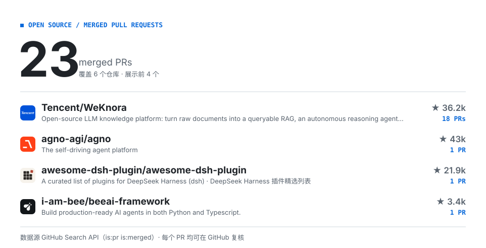

<picture>
  <source media="(prefers-color-scheme: dark)" srcset="./assets/hero-dark.svg">
  
</picture>

<!-- CONTRIB:BEGIN -->
<picture>
  <source media="(prefers-color-scheme: dark)" srcset="./assets/contrib-dark.svg">
  
</picture>
<!-- CONTRIB:END -->

截至 **2026-11-02**，在账号名下仓库之外的 **6 个公开仓库**中，有 **23 份作者 PR 已合并**，其中 **腾讯 WeKnora 18 份**。统计不含开放、关闭未合并和仅共同署名的 PR。

[查看已合并 PR](https://github.com/search?q=author%3Aicearia0219+is%3Apr+is%3Amerged+is%3Apublic+-user%3Aicearia0219&type=pullrequests) · [查看进行中的贡献](https://github.com/search?q=author%3Aicearia0219+is%3Apr+is%3Aopen+is%3Apublic&type=pullrequests)

## 精选修复

- **[腾讯 WeKnora](https://github.com/Tencent/WeKnora)** — 持续修复 Agent 工具链与数据处理问题：工具读取结果的字节预算 [#4810](https://github.com/Tencent/WeKnora/pull/4810)、Excel 工作表发现 [#4610](https://github.com/Tencent/WeKnora/pull/4610)、中文与 emoji 字符长度校验 [#3937](https://github.com/Tencent/WeKnora/pull/3937)。
- **[Agno](https://github.com/agno-agi/agno)** — 区分 Python 工具中值为 `None` 的变量和不存在的变量，并补充回归测试。[#10637](https://github.com/agno-agi/agno/pull/10637)
- **[BeeAI Framework](https://github.com/i-am-bee/beeai-framework)** — 避免确认输入阻塞异步事件循环，以确定性的回归测试覆盖冻结问题。[#1705](https://github.com/i-am-bee/beeai-framework/pull/1705)
- **[Folio](https://github.com/helsome/folio)** — 隔离 Pi Agent 重启后旧进程的迟到事件，防止旧状态干扰新进程。[#264](https://github.com/helsome/folio/pull/264)

以上均已合并。另参与 **[LangChain DeepAgents #6958](https://github.com/langchain-ai/deepagents/pull/6958)**：后续实现采用了我在 #6559 中的超时校验与提示词方案，并给予共同作者署名；该 PR 已合并，由其他作者发起，未计入上方数量。

## 代表作品

- **[dsh-memory-spaces](<https://github.com/icearia0219/dsh-memory-spaces>)**：为 DeepSeek Harness 构建由用户掌控的本地记忆空间：显式分享、可预览召回、版本记录与来源追溯。
- **[haiku\.rag · Fork](<https://github.com/icearia0219/haiku.rag>)**：围绕本地文档搜索与 RAG 做探索和改进；向上游提交的向量距离配置修复已合并。

## 技术方向

Go · Python · TypeScript · MCP · RAG · SQLite · LanceDB

关注工具调用的正确性、异步执行、上下文与文件预算，以及可复现的回归测试。

## 联系

[Email](<mailto:1749504068@qq.com>)
